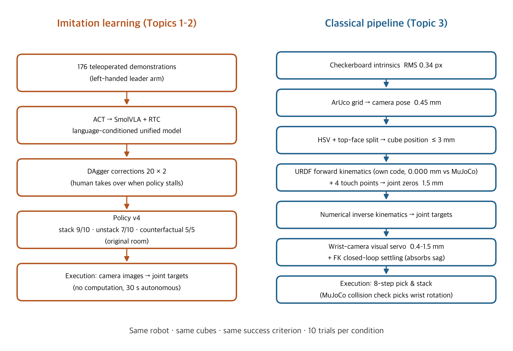
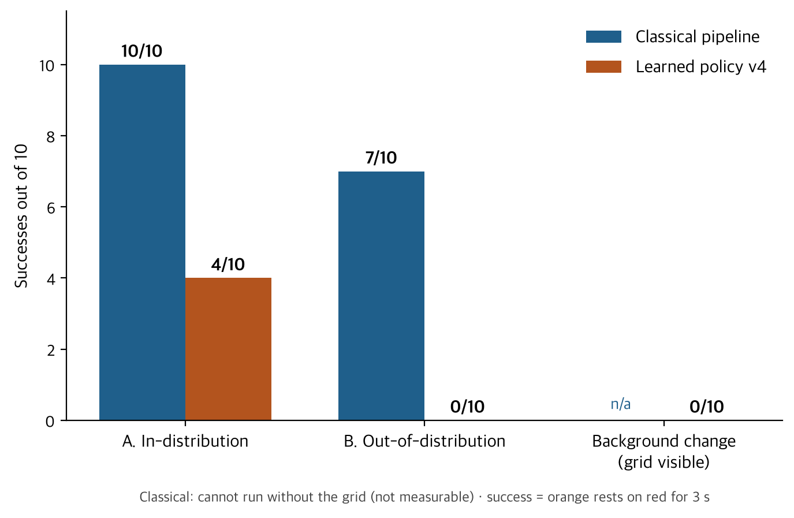
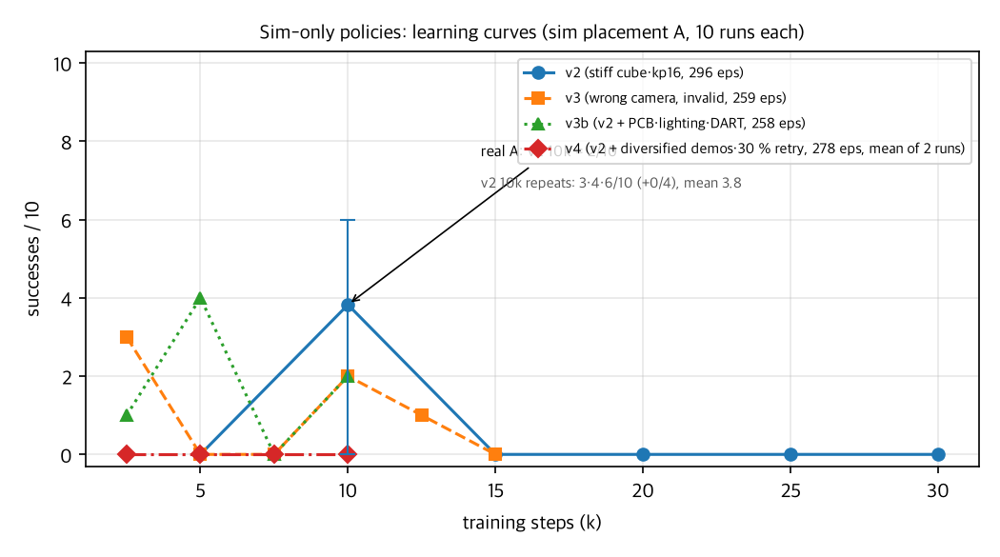

# Learned, Classical, and Sim-to-Real Manipulation on a Low-Cost Arm: A Head-to-Head Study

**Independent research project, September 13 – October 9, 2026 (27 days)**
Hardware: SO-101 leader/follower arm (Feetech STS3215 servos), two UVC cameras (top, wrist), 3 cm colored cubes, Mac mini M4 Pro. Software: LeRobot, ACT, SmolVLA, OpenCV, MuJoCo. Training: cloud GPUs (RTX 4090 / 6000 Ada / 3090 / 5090). All code, calibration data, and a daily research log are in the repository.

Repository (code, research log, data, video): https://github.com/GGOMOONG/so101-cube-stacking

## Research question

Two paradigms dominate robot manipulation today: **imitation learning**, where a policy learns from human demonstrations, and the **classical pipeline**, where perception, calibration, and kinematics are engineered explicitly. They are usually studied separately. I implemented both on the same robot for the same task, cube stacking, and asked: *where exactly does each one break, and are the failure modes the same?*

## Approach

**Task.** Pick up an orange 3 cm cube and place it on a red one. Success is defined as the orange cube resting on the red cube for at least 3 s.

**Imitation learning.** I collected 176 teleoperated demonstrations (leader arm modified for left-handed use), trained ACT for two-cube stacking, then moved to SmolVLA with real-time chunking to obtain a single language-conditioned policy that both stacks ("place the orange on the red") and unstacks. I applied DAgger twice, 20 corrections each, intervening when the policy stalled. The final policy (v4) was evaluated on stacking, unstacking, and a counterfactual test (an already-stacked scene must produce no action).

**Classical pipeline.** Without any learning, I built the full chain: checkerboard intrinsics (RMS 0.34 px), ArUco-based extrinsics and homography (0.45 mm reprojection), HSV segmentation with top-face separation and parallax correction (cube position error ≤ 3 mm), forward kinematics implemented directly from the URDF (verified against MuJoCo to 0.000 mm), joint-zero calibration by touching four grid points (1.5 mm residual), numerical inverse kinematics, wrist-camera visual servoing before grasping (0.4–1.5 mm), closed-loop settling on forward kinematics to absorb arm sag, and MuJoCo-based collision checks to choose the wrist rotation.

*Figure 1. The two pipelines solving the same task.*

**Comparison protocol.** Same robot, same cubes, same day, same success criterion, 10 trials per condition. Condition A uses cube placements inside the demonstration distribution; condition B uses ten placements outside it (mirrored sides, diagonals, far and near reach, in-line, extreme spread).

## Results

| Condition | Classical pipeline | Learned policy (v4) |
|---|---|---|
| A. In-distribution placements | **10 / 10** | **4 / 10** |
| B. Out-of-distribution placements | **7 / 10** | **0 / 10** |
| Background change (calibration grid visible) | grid required | 0 / 10 |
| Motor P-gain raised 16 → 48 | accuracy improved (sag 5.7 → 2.3 mm) | violent oscillation, unusable |

*Figure 2. Successes per condition (10 trials each).*

Development of the learned policy: ACT v1 1/10 → ACT with restructured demonstrations 8/10 → SmolVLA unified model 3/10 (2/10 after doubling training) → +DAgger 6/10 → +DAgger 9/10 (in the original room). Unstacking 10/10 → 7/10 after stacking-only corrections; counterfactual 5/5 throughout.

Failure modes by stage (classical: 10 out-of-distribution trials; learned: 20 trials):

| Stage | Classical | Learned |
|---|---|---|
| Perception | 0 | 1 (mirrored layout not recognized) |
| Grasp | 0 (grasped in all 20; wrist-camera verification in the 11 trials where it was enabled) | 5 |
| Transport | 0 | 0 |
| Place | 3 (position error > 10 mm) | 10 (pushed the red cube 7, one of them also on the edge; edge 2; no release 1) |

## Part 2. Sim-to-real: does it work with zero human demonstrations? (Sept 29 – Oct 9)

After Part 1, I asked one more question on the same robot and task: *can a policy trained only on demonstrations generated in a simulator, never on a human demonstration, succeed on the physical arm?*

**Simulator.** I built a MuJoCo simulator on top of Part 1's calibration and kinematics. Dynamics were fitted by replaying the commands of 12 real demonstrations (command delay 3 frames, per-joint gains, validation RMSE 0.4–1.3°). MuJoCo's default contact was too soft, letting the jaw plates sink 5.6 mm into the cube; a stiff contact fixed it (gripper reading while holding 13.5 vs 13.8 real). The top camera reused Part 1's intrinsics and homography; the wrist camera was hand-eye calibrated from 30 ArUco views and checked against a ruler (lens to jaw tip 110 mm). Appearance was matched to real image statistics.

**Demonstration generator.** An inverse-kinematics planner generates 320 demonstrations per dataset following the statistics of the real demonstrations (approach direction, speed, episode length). Lighting, colour, size and camera pose are randomized, and DART-style joint noise is injected into the executed commands while the clean commands are recorded. SmolVLA was fine-tuned on four datasets (v1 soft cube; v2 stiff cube; v3 invalid due to a wrist-camera miscalibration; v3b = v2 + PCB geometry, softer shadows, DART).

**Results.**

*Figure 3. Sim-only policies: simulated successes per checkpoint (placement A, 10 trials each). All three peak early and then decline.*

| Policy | Real demos | Real A (in-dist.) | Real B (out-of-dist.) |
|---|---|---|---|
| v4 (real-demo policy, Part 1) | 216 | 4 / 10 | 0 / 10 |
| v5 = v4 + 3rd DAgger round | 236 | 3 / 10 | 1 / 10 |
| **sim v2, 10k steps** | **0** | **2 / 10** | 0 / 10 |
| sim v3b, 10k steps | 0 | 0 / 10 | – |
| sim v3b, 5k steps (best in sim) | 0 | 0 / 10 | – |

- **A policy with zero real demonstrations completed the stack on the real arm** (sim v2, 2/10). The real-demo policies v4/v5, trained on 216–236 demonstrations, score 3–4/10 in the same environment, so the two are in the same range (n=10; the difference is within noise). A behaviour learned in simulation, grasping with the wrist rotated 90°, appeared unchanged on the real robot. On out-of-distribution placements it scored 0/10: the 4/10 it achieved on those placements in simulation did not carry over (the real-demo policy v4 also scored 0/10 there).
- **Even inside the simulator the ceiling is about 4/10, and more training makes it worse.** All three datasets peaked at 2.5k–10k steps (v2 at 10k: 3, 4 and 6/10 over three repeats) and fell to 0–2/10 afterwards; late checkpoints grasp but place at a consistently wrong offset (a memorized trajectory). This holds after dynamics, contact, cameras and lighting were matched by measurement, Testing the hypothesis that planner demonstrations were too uniform, I generated a diversified set (v4, 278 episodes: three approach strategies, speed variation, hesitation, and a deliberate miss-and-retry in 30 %) and trained on it: **0/10 at every checkpoint**, reproduced over two independent training runs. The bottleneck is neither physics nor a lack of demonstration diversity.
- **Simulated success did not predict real transfer.** v3b matched v2 in simulation (best 4/10) but scored 0/10 on the real arm at both checkpoints (0/20 combined). At least one of the additions (PCB geometry, shadow lighting, DART noise) hurt transfer; which one was not isolated.
- **Running the real-demo policy in simulation decomposed the real-to-sim gap.** v4 scores 4/10 real and 0/10 in sim. Removing the command delay or softening the pan/roll gains restored grasping from 3/8 to 8/8; hidden compliance, friction and lighting had little effect.
- **One camera-model error cost a whole dataset.** While fitting the wrist camera to cube silhouettes, a 15 mm error in the assumed cube position moved the camera 9 mm the wrong way; the resulting v3 policy scored 0/10 on the real arm. A real-world observation, the moving jaw pressing down on the cube, exposed the error. The optimizer had reported an improved IoU; its assumption was wrong. An independent measurement with a ruler became the reference.

## Findings

1. **The two paradigms fail in different places.** The classical pipeline never failed to grasp; all of its failures were open-loop placement errors. The learned policy degraded with every change to what it sees: 9/10 in the original room, 4/10 after moving, 0/10 on an unfamiliar background, 0/10 on unfamiliar placements.
2. **Each method is bound to its environmental assumptions, but the classical ones are visible.** The classical pipeline depends on the grid, the calibration, and the motor gain; when out-of-distribution trials first failed (0/8), the causes could be traced and fixed in code (placement offset transformation, straight-line descent, wrist-wrap guard, grasp verification), raising the result to 7/10. The learned policy's assumptions, background, layout, and even the arm's control dynamics, are implicit and can only be changed by collecting new data.
3. **A learned policy also learns the hardware's control dynamics.** Raising the position gain, which improved the classical pipeline, made the learned policy oscillate: it had implicitly learned the arm's slow tracking at the gain used during demonstration.
4. **"The URDF is wrong" was only half right.** After seven failed grasps, measurements showed the grasp centre 13/7 mm from the modelled point and the jaw axis ~40° off; compensation values plus wrist-camera visual servoing gave the first success. Re-examined while building the simulator (10-01), the 40° turned out to be a wrist-roll zero error (~36°) in the 09-23 kinematic calibration, not URDF geometry, and the 13 mm follows from the single-moving-jaw geometry ((open gap − cube)/2). The "pads ~20 mm inside the tips" inferred at the time do not exist. The compensation covered the symptom exactly, so the real pipeline worked — but the cause had been misattributed.
5. **Data structure mattered more than training budget.** ACT v1's 1/10 came from demonstrations with a "pick twice" structure; doubling the unified model's training (30k → 60k steps) did not help (3/10 → 2/10), and five-cube stacking stayed at 0/10 with 100 demonstrations and 100k steps. DAgger corrections worked (2/10 → 9/10) but shifted the balance against the uncorrected skill (unstacking 10/10 → 7/10).

6. **Simulated data alone reaches the same range as real-demonstration policies, and diversifying the demonstrations did not raise it.** Matching physics and cameras by measurement could be finished and its effect measured; the diversity hypothesis was tested and rejected (v4, 0/10), leaving data volume and the absence of vision-driven corrections in planner demonstrations as the remaining candidates.
7. **A fit with a wrong assumption gives a confidently wrong answer.** An optimization result must be checked once against an independent measurement. Here that role was played by a ruler and by the real robot's failure mode.

## Relation to prior work

SmolVLA (Shukor et al. 2025) reports real-time control on consumer hardware from community data with asynchronous inference; this project's RTC result (0/10 without, 6/10 with) agrees. Its real-robot evaluations, however, take place in the environment where the demonstrations were collected, so the drop after moving desks (9/10 → 4/10) does not appear in the paper's numbers. DART (Laskey et al. 2017) injects noise into the demonstrator's policy to record recovery behaviour and reports an average 62 % improvement over behaviour cloning in grasping in clutter; this project's v3b (fixed 2° noise on the planner's executed commands, together with two appearance changes) transferred worse, 0/20 on the real arm. The differences: the noise level was not matched to the policy's error, the evaluation was sim-to-real rather than same-environment, and the factors were not isolated. Domain randomization (Tobin et al. 2017) obtained a real-world object localizer accurate to 1.5 cm from non-realistic random textures alone; this project took the opposite route of matching the real appearance and perturbing it mildly. The sim policy's 2/10 on the real arm shows that even mild randomization transfers partially; its 0/10 out of distribution suggests the randomization range was too narrow.

**Statistical reading.** The 95 % confidence interval of a 10-trial measurement is 0–31 % for 0/10, 3–56 % for 2/10, 12–74 % for 4/10 and 69–100 % for 10/10. Claims that survive: classical vs. learned (10/10 vs. 4/10, 7/10 vs. 0/10), counterfactual 15/15, DAgger before/after (2 → 9/10), sim v3b 0/20 vs. sim v2 2/10 on the real arm. v4 vs. v5, sim v2's real 2/10 vs. the real-demo policies' 3–4/10, and 1–2-trial differences between sim checkpoints can only be called "the same range".

## Limitations

The classical result on condition B was obtained after fixing bugs that the first attempt exposed; the learned policy was not given the equivalent chance (that would require new demonstrations and retraining). The move to a new room lowered the learned policy's in-distribution score before condition B was measured, so placement and environment effects are not separated. Cube positions in condition A were varied only by about ±5 mm.

Limitations of Part 2: real evaluations use 10 trials per condition, so sim v2 (2/10), sim v3b (0/10) and the real-demo policies (3–4/10) are not statistically separable. Simulated learning curves are single measurements of 10 trials per checkpoint (only 10k was repeated). Mixed real+sim training was not carried out.

## What comes next

- **Closed-loop placement** using the wrist and top cameras, since placement is the weak stage for both methods (measurement bias from gripper occlusion is currently 12–27 mm).
- **A hybrid controller**: classical approach and alignment, learned grasp and release.
- **More simulated data and mixed training**: since diversification hurt, the next steps are two to three times more single-strategy demonstrations, and mixed training on a few real demonstrations plus simulated ones.
- **Bimanual extension** with a second SO-101, reusing the grid-based calibration.

## Why this matters to me

I came to robotics from outside computer science. This project taught me that the interesting questions are not "does it work" but "why does it stop working, and is the reason visible". I want to study manipulation where learned and engineered components are combined deliberately, with each responsible for what it does best, and I want to keep working the way this project forced me to: record everything, including the seven failed grasps, and let the failures decide the next experiment.

## References

1. Zhao, T. Z., Kumar, V., Levine, S., Finn, C. (2023). *Learning Fine-Grained Bimanual Manipulation with Low-Cost Hardware* (ACT). RSS 2023. arXiv:2304.13705
2. Shukor, M. et al. (2025). *SmolVLA: A Vision-Language-Action Model for Affordable and Efficient Robotics*. arXiv:2506.01844
3. Black, K., Galliker, M., Levine, S. (2025). *Real-Time Execution of Action Chunking Flow Policies* (RTC). arXiv:2506.07339
4. Ross, S., Gordon, G., Bagnell, J. A. (2011). *A Reduction of Imitation Learning and Structured Prediction to No-Regret Online Learning* (DAgger). AISTATS 2011
5. Cadene, R. et al. (2024). *LeRobot: State-of-the-art Machine Learning for Real-World Robotics in PyTorch*. github.com/huggingface/lerobot
6. TheRobotStudio. *SO-ARM100 / SO-101*. github.com/TheRobotStudio/SO-ARM100
7. Todorov, E., Erez, T., Tassa, Y. (2012). *MuJoCo: A physics engine for model-based control*. IROS 2012
8. Bradski, G. (2000). *The OpenCV Library*. Dr. Dobb's Journal of Software Tools
9. Laskey, M., Lee, J., Fox, R., Dragan, A., Goldberg, K. (2017). *DART: Noise Injection for Robust Imitation Learning*. CoRL 2017. arXiv:1703.09327
10. Tobin, J. et al. (2017). *Domain Randomization for Transferring Deep Neural Networks from Simulation to the Real World*. IROS 2017. arXiv:1703.06907

## Statement on tools

This project was carried out together with an AI coding assistant (Claude). The division of work: **myself** — the research questions and the decisions to move between topics, hardware assembly, modification and diagnosis, all demonstration collection, every physical experiment with its observation and success judgment, the decision at each step about what to do next, and the final interpretation of results. **The AI assistant** — most of the code for calibration, kinematics, the simulator, the demonstration generator and the evaluation tools, the analysis scripts and figures, document drafts, and, within limits I approved, autonomous execution of robot-free simulation evaluations (e.g. overnight on Oct 1–2). Experiments were designed by the assistant proposing and me adopting, modifying or rejecting. The daily research log records this process as it happened, including an error made by the assistant (a wrong assumption in the wrist-camera fit on Oct 1) and how a real-world observation corrected it.
