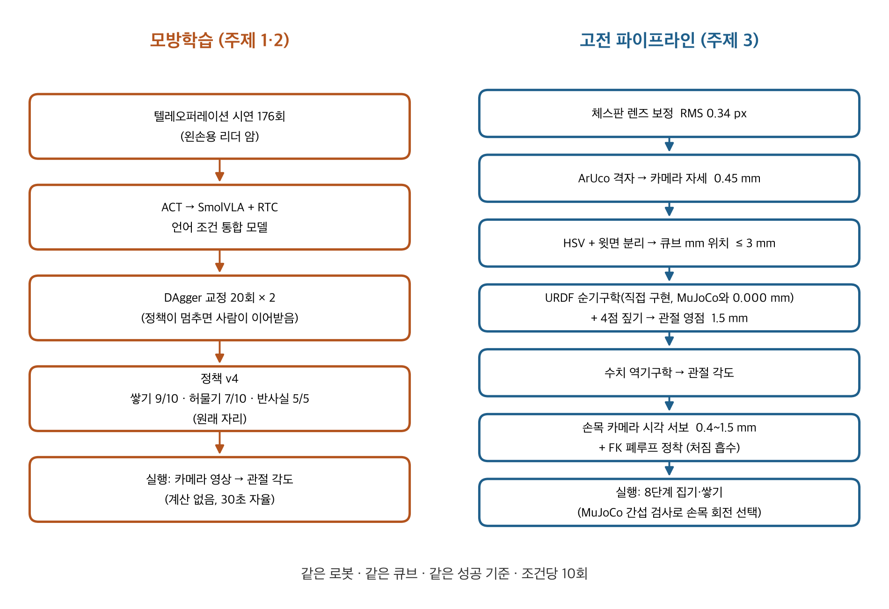
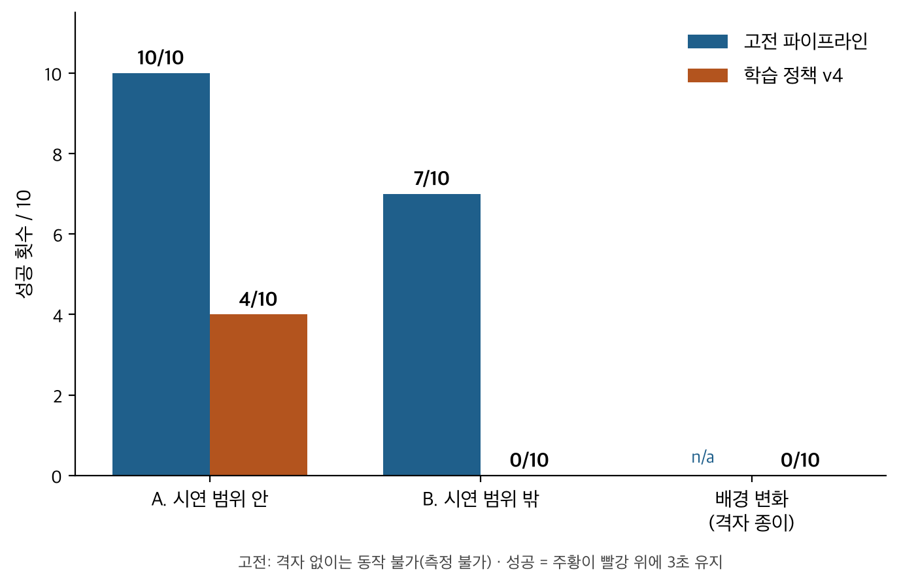
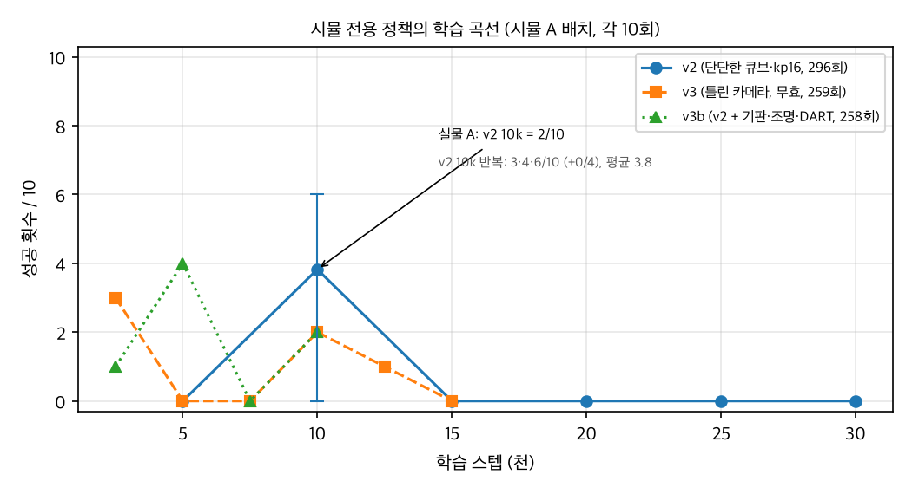

# 저가형 로봇 팔에서의 학습 조작, 고전 조작, 시뮬레이션→실물: 정면 비교 연구

**독립 연구 프로젝트, 2026년 9월 13일 ~ 10월 9일 (27일)**
장비: SO-101 리더/팔로워 암(Feetech STS3215 서보), UVC 카메라 2대(탑, 손목), 3 cm 색 큐브, Mac mini M4 Pro. 소프트웨어: LeRobot, ACT, SmolVLA, OpenCV, MuJoCo. 학습: 클라우드 GPU(RTX 4090 / 6000 Ada / 3090 / 5090). 코드, 보정 데이터, 일자별 연구노트 전부를 저장소에 남겼다.

## 연구 질문

오늘날 로봇 조작에는 두 패러다임이 있다. 사람의 시연에서 정책을 배우는 **모방학습**과, 인식·보정·기구학을 명시적으로 설계하는 **고전 파이프라인**이다. 둘은 보통 따로 연구된다. 나는 같은 로봇, 같은 작업(큐브 쌓기)에 둘을 모두 구현하고 이렇게 물었다. *각 방식은 정확히 어디서 무너지며, 무너지는 방식은 같은가?*

## 접근

**작업.** 주황 3 cm 큐브를 집어 빨강 큐브 위에 놓는다. 성공은 주황이 빨강 위에 3초 이상 놓여 있는 것으로 정의했다.

**모방학습.** 텔레오퍼레이션으로 시연 176회를 모았다(리더 암은 왼손잡이용으로 개조). 2단 쌓기에 ACT를 학습한 뒤, 실시간 청킹(RTC)을 붙인 SmolVLA로 옮겨 "주황을 빨강 위에 놓아라"와 허물기를 한 모델이 문장으로 구분하는 언어 조건 정책을 만들었다. 정책이 멈추는 순간 사람이 이어받는 DAgger 교정을 20회씩 두 번 넣었다. 최종 정책(v4)은 쌓기, 허물기, 반사실 시험(이미 쌓인 장면에서는 아무 동작도 하지 않아야 함)으로 평가했다.

**고전 파이프라인.** 학습 없이 전체 사슬을 직접 만들었다. 체스판 렌즈 보정(RMS 0.34 px), ArUco 기반 카메라 자세와 호모그래피(재투영 0.45 mm), 윗면 분리와 시차 보정을 넣은 HSV 분할(큐브 위치 오차 ≤ 3 mm), URDF에서 직접 구현한 순기구학(MuJoCo와 0.000 mm 일치 검증), 격자 4점 짚기로 구한 관절 영점(잔차 1.5 mm), 수치 역기구학, 잡기 직전 손목 카메라 시각 서보(0.4~1.5 mm), 팔의 처짐을 흡수하는 순기구학 기반 폐루프 정착, 손목 회전을 고르는 MuJoCo 충돌 검사.

*그림 1. 같은 작업을 푸는 두 파이프라인.*

**비교 절차.** 같은 로봇, 같은 큐브, 같은 날, 같은 성공 기준, 조건당 10회. 조건 A는 시연 분포 안의 큐브 배치, 조건 B는 분포 밖 배치 10종(좌우 바꿈, 대각선, 멀리·가까이, 앞뒤 일렬, 양끝).

## 결과

| 조건 | 고전 파이프라인 | 학습 정책 (v4) |
|---|---|---|
| A. 분포 안 배치 | **10 / 10** | **4 / 10** |
| B. 분포 밖 배치 | **7 / 10** | **0 / 10** |
| 배경 변화(보정 격자가 보임) | 격자 필수 | 0 / 10 |
| 모터 P 게인 16 → 48 | 정확도 향상(처짐 5.7 → 2.3 mm) | 심한 진동, 사용 불가 |

*그림 2. 조건별 성공 횟수(각 10회).*

학습 정책의 발전: ACT v1 1/10 → 시연 구조를 고친 ACT 8/10 → SmolVLA 통합 모델 3/10(학습을 두 배로 늘린 뒤 2/10) → DAgger 후 6/10 → DAgger 후 9/10(원래 방에서). 허물기는 10/10에서 쌓기 교정만 넣은 뒤 7/10으로, 반사실은 내내 5/5.

단계별 실패(고전: 분포 밖 10회, 학습: 20회):

| 단계 | 고전 | 학습 |
|---|---|---|
| 인식 | 0 | 1 (좌우 바꾼 배치를 인식 못 함) |
| 잡기 | 0 (20회 전부 잡음, 그중 11회는 손목 카메라로 물림 확인) | 5 |
| 옮기기 | 0 | 0 |
| 놓기 | 3 (위치 오차 10 mm 초과) | 10 (빨강 밀림 7, 그중 1회는 모서리 동반 / 모서리 2 / 놓지 못함 1) |

## 2부. 시뮬레이션→실물: 사람 시연 없이 되는가 (9월 29일 ~ 10월 9일)

1부가 끝난 뒤 같은 로봇·같은 작업으로 질문을 하나 더 던졌다. *사람 시연을 한 번도 쓰지 않고, 시뮬레이터가 만든 시연만으로 학습한 정책이 실물에서 되는가?*

**시뮬레이터.** 1부의 보정값과 기구학 위에 MuJoCo 시뮬레이터를 세웠다. 실물 시연 12회의 명령을 재생해 동역학을 맞추고(명령 지연 3프레임, 관절별 게인, 검증 RMSE 0.4~1.3°), MuJoCo 기본 접촉이 너무 물러 턱이 큐브에 5.6 mm 파고드는 문제를 단단한 접촉으로 고쳤다(쥔 상태 그리퍼 읽기 13.5, 실물 13.8). 탑 카메라는 1부의 렌즈·호모그래피를 그대로 썼고, 손목 카메라는 ArUco 30장 hand-eye 보정을 자 실측(렌즈–턱 끝 110 mm)으로 검증했다. 외관은 실물 사진 통계에 맞췄다.

**시연 생성기.** 역기구학 계획기가 실물 시연의 통계(접근 방향·속도·회차 길이)를 따라 시연을 320회씩 자동 생성한다. 조명·색·크기·카메라 위치를 무작위화하고, DART식으로 실행 명령에 관절 잡음을 넣되 기록은 깨끗한 명령으로 남겼다. 데이터셋 네 개(v1 무른 큐브, v2 단단한 큐브, v3 손목 카메라 오보정으로 무효, v3b v2 + 기판·조명·DART)로 SmolVLA를 미세조정했다.

**결과.**

*그림 3. 시뮬 전용 정책의 체크포인트별 시뮬 성공 횟수(A 배치, 각 10회). 세 번 모두 초반이 최고이고 이후 떨어진다.*

| 정책 | 실물 시연 수 | 실물 A (범위 안) | 실물 B (범위 밖) |
|---|---|---|---|
| v4 (실물 시연 정책, 1부) | 216 | 4 / 10 | 0 / 10 |
| v5 = v4 + DAgger 3차 | 236 | 3 / 10 | 1 / 10 |
| **시뮬 v2 10k** | **0** | **2 / 10** | 0 / 10 |
| 시뮬 v3b 10k | 0 | 0 / 10 | – |
| 시뮬 v3b 5k (시뮬 최고점) | 0 | 0 / 10 | – |

- **실물 시연 0회인 정책이 실물에서 쌓기를 완수했다**(시뮬 v2, 2/10). 실물 시연 216~236회로 학습한 v4·v5가 같은 환경에서 3~4/10이므로 같은 구간이다(n=10, 차이는 잡음 범위). 시뮬에서 배운 "손목을 90° 돌려 잡기"가 실물에서 그대로 나왔다. 범위 밖 배치에서는 0/10으로, 시뮬 안의 B 4/10이 실물로 옮겨지지 않았다(실물 시연 정책 v4도 B 0/10).
- **시뮬 안에서도 천장은 약 4/10이고, 더 학습하면 떨어진다.** 세 데이터셋 모두 2.5k~10k 스텝이 최고였고(v2 10k 반복 3·4·6/10) 이후 0~2/10. 후반 체크포인트는 잡기는 하지만 놓기 위치를 일정하게 비켜 놓는다(외운 궤적). 동역학·접촉·카메라·조명을 실측으로 맞춘 뒤에도 그렇다 → 병목은 물리가 아니라 **시연의 다양성**이다. 계획기 시연은 항상 같은 방식으로 성공만 하므로 "보고 고치는" 행동을 배울 재료가 없다.
- **시뮬 내 성공률은 실물 전이를 예측하지 못했다.** v3b는 시뮬에서 v2와 비슷했지만(최고 4/10) 실물에서는 두 체크포인트 모두 0/10(합계 0/20). 기판 형상·그림자 조명·DART 교란 중 적어도 하나가 전이를 해쳤고, 어느 것인지는 분리하지 못했다.
- **실물 정책을 시뮬에 넣어 실물→시뮬 갭을 분해했다.** v4는 실물 4/10, 시뮬 0/10. 요인을 하나씩 바꾸면 명령 지연을 0으로 하거나 pan·roll 게인을 완화할 때 잡기가 3/8 → 8/8로 회복되고, 처짐·마찰·조명은 거의 영향이 없었다.
- **카메라 모델 오류 한 번이 데이터셋 하나를 날렸다.** 손목 사진과 시뮬 렌더의 큐브 실루엣을 맞출 때 큐브 위치 가정이 15 mm 틀려 카메라를 9 mm 잘못 옮겼고, 그 카메라로 만든 v3는 실물 0/10이었다. 실물에서 "벌어지는 턱이 주황을 누른다"는 관찰이 오류를 드러냈다. 최적화는 IoU가 올랐다고 보고했지만 가정이 틀렸던 것이다. 독립된 측정(자)이 기준점이 됐다.

## 발견

1. **두 패러다임은 서로 다른 곳에서 무너진다.** 고전 파이프라인은 잡기에 한 번도 실패하지 않았고, 실패는 전부 개루프 놓기 오차였다. 학습 정책은 보는 장면이 바뀔 때마다 떨어졌다. 원래 방 9/10, 이사 후 4/10, 낯선 배경 0/10, 낯선 배치 0/10.
2. **각 방식은 환경 가정에 묶여 있지만, 고전의 가정은 눈에 보인다.** 고전 파이프라인은 격자, 보정, 모터 게인에 의존한다. 분포 밖 시험이 처음에 실패했을 때(0/8) 원인을 추적해 코드로 고칠 수 있었고(놓기 오프셋 변환, 직선 하강, 손목 회전 보호, 물림 확인), 결과가 7/10으로 올라갔다. 학습 정책의 가정(배경, 배치, 심지어 팔의 제어 동역학)은 암묵적이며 새 데이터를 모아야만 바꿀 수 있다.
3. **학습 정책은 하드웨어의 제어 동역학까지 학습한다.** 고전 파이프라인을 개선한 게인 상향이 학습 정책은 진동하게 만들었다. 정책은 시연 당시 게인에서의 느린 추종을 함께 외우고 있었다.
4. **"URDF가 틀렸다"는 처음 진단은 절반만 맞았다.** 잡기 실패 7회 뒤 실측으로 잡기 중심이 계산 기준점에서 13/7 mm 어긋나고 턱 축이 약 40° 돌아가 있음을 찾아 보정값으로 덮었고, 손목 카메라 시각 서보로 첫 성공을 얻었다. 그러나 시뮬레이터를 만들며 재검토한 결과(10-01) 40°는 URDF 기하가 아니라 09-23 운동학 보정의 손목 롤 영점 오차(약 36°)였고, 13 mm는 한쪽 턱만 움직이는 그리퍼의 기하((벌린 간격 − 큐브)/2)로 설명됐다. 당시 추정했던 "끝에서 20 mm 안쪽 패드"는 실물에 없다. 보정값이 현상을 정확히 덮었기에 실물 파이프라인은 옳게 동작했지만, 원인을 잘못 짚은 채 넘어갔던 셈이다.
5. **데이터 구조가 학습량보다 중요했다.** ACT v1의 1/10은 "두 번 집기" 구조의 시연 때문이었고, 통합 모델의 학습을 두 배(3만 → 6만 스텝)로 늘려도 3/10 → 2/10으로 나아지지 않았으며, 5단 쌓기는 시연 100회·10만 스텝에도 0/10이었다. DAgger 교정은 효과가 있었지만(2/10 → 9/10) 교정하지 않은 능력의 균형을 무너뜨렸다(허물기 10/10 → 7/10).

6. **시뮬 데이터만으로도 실물 시연 정책과 같은 구간에 닿지만, 그 이상은 시연의 다양성이 막는다.** 물리·카메라를 실측으로 맞추는 일은 끝낼 수 있었고 효과도 측정됐다. 남은 병목은 계획기가 만든 시연이 사람 시연보다 균일하다는 점이다.
7. **맞춤(fitting)은 가정이 틀리면 자신 있게 틀린 답을 준다.** 최적화 결과는 한 번은 독립된 측정으로 대조해야 한다. 이 프로젝트에서 그 역할을 한 것은 자와 실물의 실패 양상이었다.

## 한계

고전 파이프라인의 조건 B 결과는 첫 시도가 드러낸 버그를 고친 뒤 얻은 것이다. 학습 정책에는 같은 기회를 주지 않았다(새 시연과 재학습이 필요하다). 새 방으로 옮긴 것이 조건 B 측정 전에 학습 정책의 분포 안 점수를 낮췄으므로 배치 효과와 환경 효과가 분리되지 않는다. 조건 A의 큐브 위치 흩뜨림은 약 ±5 mm에 그쳤다.

2부의 한계: 실물 평가는 조건당 10회라 시뮬 v2 2/10과 v3b 0/10, 실물 정책 3~4/10의 차이는 통계적으로 구분되지 않는다. 시뮬 학습 곡선은 체크포인트당 10회 1회 측정(10k만 재현)이다. 혼합 학습(실물 + 시뮬 시연)은 수행하지 못했다.

## 다음 연구

- **폐루프 놓기**: 놓기는 두 방식 모두의 약점이므로 손목·탑 카메라로 닫는다(현재는 그리퍼 가림으로 측정 치우침 12~27 mm).
- **혼합 제어기**: 접근과 정렬은 고전으로, 잡기와 놓기는 학습으로.
- **시뮬 시연의 다양화**: 계획기에 접근 전략·속도·실패 후 재시도를 섞고 관측(화면 질감·노출)도 무작위화해 과적합 천장(약 4/10)을 올린다. 실물 시연 소량 + 시뮬 시연 혼합 학습은 그다음이다.
- **양팔 확장**: 두 번째 SO-101을 격자 보정을 재사용해 추가한다.

## 이 연구가 나에게 갖는 의미

나는 컴퓨터과학 바깥에서 로봇공학으로 왔다. 이 프로젝트는 흥미로운 질문이 "되는가"가 아니라 "왜 안 되기 시작하는가, 그 이유가 보이는가"라는 것을 가르쳐 주었다. 나는 학습된 요소와 설계된 요소를 각자 잘하는 일에 의도적으로 나눠 맡기는 조작 연구를 하고 싶고, 이 프로젝트가 강제한 방식대로 계속 일하고 싶다. 실패한 잡기 7회까지 전부 기록하고, 실패가 다음 실험을 정하게 하는 방식으로.

## 참고문헌

1. Zhao, T. Z., Kumar, V., Levine, S., Finn, C. (2023). *Learning Fine-Grained Bimanual Manipulation with Low-Cost Hardware* (ACT). RSS 2023. arXiv:2304.13705
2. Shukor, M. 외 (2025). *SmolVLA: A Vision-Language-Action Model for Affordable and Efficient Robotics*. arXiv:2506.01844
3. Black, K., Galliker, M., Levine, S. (2025). *Real-Time Execution of Action Chunking Flow Policies* (RTC). arXiv:2506.07339
4. Ross, S., Gordon, G., Bagnell, J. A. (2011). *A Reduction of Imitation Learning and Structured Prediction to No-Regret Online Learning* (DAgger). AISTATS 2011
5. Cadene, R. 외 (2024). *LeRobot: State-of-the-art Machine Learning for Real-World Robotics in PyTorch*. github.com/huggingface/lerobot
6. TheRobotStudio. *SO-ARM100 / SO-101*. github.com/TheRobotStudio/SO-ARM100
7. Todorov, E., Erez, T., Tassa, Y. (2012). *MuJoCo: A physics engine for model-based control*. IROS 2012
8. Bradski, G. (2000). *The OpenCV Library*. Dr. Dobb's Journal of Software Tools
9. Laskey, M., Lee, J., Fox, R., Dragan, A., Goldberg, K. (2017). *DART: Noise Injection for Robust Imitation Learning*. CoRL 2017. arXiv:1703.09327
10. Tobin, J. 외 (2017). *Domain Randomization for Transferring Deep Neural Networks from Simulation to the Real World*. IROS 2017. arXiv:1703.06907

## 작성 방식에 관한 고지

이 프로젝트의 코드와 문서는 AI 코딩 도구(Claude)의 도움을 받아 작성했다. 실험 설계, 하드웨어 조립과 진단, 시연 수집, 모든 실물 실험의 수행과 관찰, 결과 판정과 해석은 본인이 직접 했다. 연구노트에는 도구와 주고받은 판단 과정이 그대로 남아 있다.
